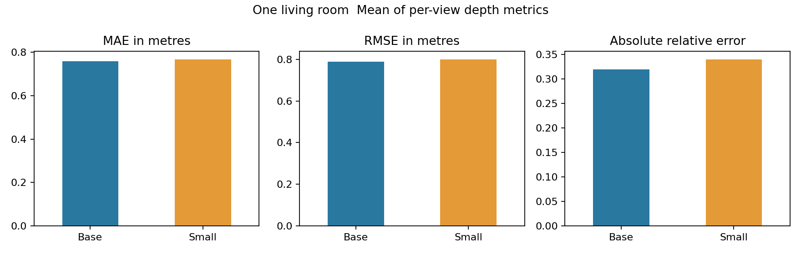
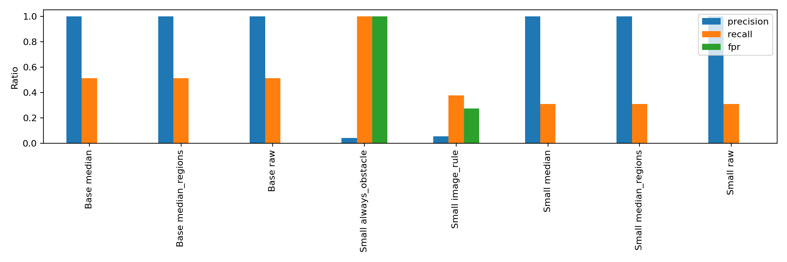

# Monocular Room Obstacle Detection

A reproducible computer-vision research prototype that estimates metric depth from RGB images and compares simple near-obstacle detectors in **one NYU-labelled living-room scene**. Built with Python, PyTorch, OpenCV and Google Colab; developed with AI assistance.

[](https://colab.research.google.com/github/suji2511/monocular-room-obstacle-detection/blob/main/Living_Room_Obstacle_Detection.ipynb)

## What works

- Depth Anything V2 **Small and Base indoor metric models**, run sequentially on a Tesla T4.
- RGB → estimated depth → near-obstacle mask → illustrative stop/clear rule.
- Raw depth thresholding, median filtering, and median filtering plus connected-region removal.
- Always-obstacle and Canny-edge heuristic baselines.
- MAE, RMSE, AbsRel, pixel precision/recall/false-positive rate and synchronised inference latency.
- Brightness reduction and Gaussian-blur perturbations for Small.
- Per-view CSVs, prediction arrays in downloadable runs, model hashes, exact split indices and figures.

## Measured pilot results

The scene is `living_room_0000`: **2 development views, 1 excluded view, 3 test views**. It was selected by the largest labelled living-room view count, with alphabetical tie-breaking, before evaluating models. Views remain correlated.

| Model | MAE (m) | RMSE (m) | AbsRel | Median inference (ms) |
|---|---:|---:|---:|---:|
| Small | 0.7677 | 0.7997 | 0.3400 | 82.84 |
| Base | 0.7586 | 0.7882 | 0.3194 | 188.85 |



For raw thresholding, pixel recall was **30.87% for Small** and **51.28% for Base**. Their precision was approximately 99.96% and 100%, respectively, on this small pilot. High precision does not compensate for missed near-obstacle pixels. Median filtering changed recall by only about 0.012 percentage points; region removal added no further benefit on these views. The changes are not evidence of a substantial improvement.

Brightness reduction and blur happened to reduce Small's depth error on these three views. This is a dataset-specific observation, not evidence that image degradation generally helps.



## Protocol

Depth errors use measured `rawDepths`, not inpainted reference values. Valid depth is 0.1–10 m. The fixed crop is rows `[45,471)` and columns `[41,601)`, in zero-based Python indexing. Predictions are not rescaled using test ground truth. Depth summaries are means of per-view metrics.

The obstacle region spans 20–80% of image width and 20–70% of height. The reference marks labelled **nonfloor** surfaces nearer than 2 m. Raw depth missingness and unlabelled pixels are excluded from scoring; labelled floor pixels remain negative examples. Floor labels construct the reference only and are never supplied to the detector. Pixel scores pool confusion counts over the test views.

The prediction threshold is selected from 1.5, 2 and 2.5 m using only Small's development views, then frozen for both models and all variants. The selected threshold was 2.5 m. Median kernel 3, minimum component area 32 pixels and a 3% stop-decision fraction are fixed parameters. Refer to `run_metadata.json` for exact settings.

Timing uses the same T4 and input size 518, two warm-up calls and three repetitions per test view, with CUDA synchronisation. It includes inference preprocessing but excludes model loading, disk I/O and detector processing. Detector timing is recorded separately. There are only nine timed calls per model, so these are pilot measurements.

## Run

**Recommended:** click Open in Colab, select a GPU runtime and run the cells in order. The notebook downloads the official code, checkpoints and labelled dataset, executes the study and downloads its evidence bundle. No training is required. Colab storage is temporary; save the downloaded results.

To run in your own Python environment:

```bash
pip install -r requirements.txt
python case_study.py --repo /path/to/Depth-Anything-V2 --data /path/to/nyu_depth_v2_labeled.mat --out ./outputs/run1
```

Check out upstream commit `a561b849ebae10a6f5ef49e26c83cbbcd36c71bf`. Place the official Hypersim Small and Base checkpoints in its `metric_depth/checkpoints/` directory. The Colab setup cells show the download URLs. Use `--models Small` for a smaller run. The script supports CUDA or CPU; timings will differ by hardware.

Run metric tests without weights or a GPU:

```bash
pip install numpy
python -m unittest discover -s tests -v
```

## Repository contents

- `case_study.py`: data selection, inference, detectors, evaluation and figures.
- `Living_Room_Obstacle_Detection.ipynb`: self-contained Colab execution path.
- `tests/`: hand-calculated tests for metric counts, masks and undefined cases.
- `results/`: actual pilot CSVs, configuration, provenance and plots.

Dataset files, pretrained weights, raw photos and prediction arrays are not committed. The source snapshot in the original experiment metadata describes the Colab pilot; the portfolio version adds configurable paths and clearer documentation without changing metric logic. `results/INTERPRETATION_LIMITS.txt` is the original pilot note, retained for provenance; academic framing there belongs to the earlier learning session. This repository is a personal project.

## Limits and next work

This is an offline near-obstacle **proxy**, not a complete autonomous robot or validated collision-avoidance system. It uses handheld dataset camera views, not a calibrated robot camera. A one-view gap does not make the remaining views independent. The dataset's living-room label can cover a combined living/dining area. Three test views cannot establish generalisation, statistical significance or deployment safety. No model fine-tuning or new neural architecture is claimed.

Next steps include more views of the same room, explicit floor estimation from predicted geometry, a calibrated robot viewpoint, a stronger obstacle baseline and eventually a multi-room evaluation. The current results do not support claiming that the filtering extension substantially improves the model.

## Attribution and assistance

- [Depth Anything V2 — Yang et al., 2024](https://arxiv.org/abs/2406.09414), [official metric code and models](https://github.com/DepthAnything/Depth-Anything-V2/tree/main/metric_depth).
- [NYU Depth V2](https://cs.nyu.edu/~fergus/datasets/nyu_depth_v2.html); cite Silberman et al., *Indoor Segmentation and Support Inference from RGBD Images*, ECCV 2012.
- Implementation and documentation developed with OpenAI Codex assistance. Upstream model training and dataset creation are credited to their original authors.

Upstream code, weights and dataset retain their own terms. No third-party weights or dataset files are redistributed here. No licence grant over third-party materials is implied.
